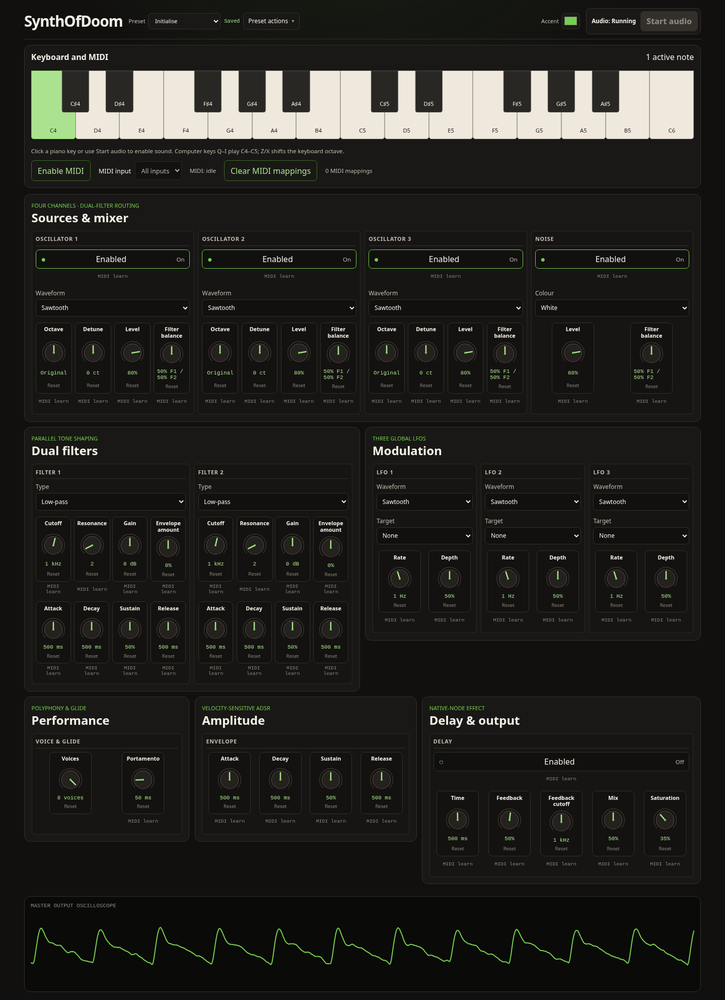
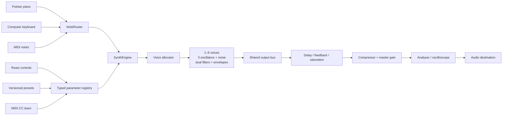

# SynthOfDoom

SynthOfDoom is a playable polyphonic synthesiser that runs entirely in the browser. Three oscillators, coloured noise, dual filters, envelopes, modulation, delay, presets, computer-keyboard input, Web MIDI, and per-control MIDI learn are driven by a typed Web Audio engine rather than samples or a server.



This is a ground-up React and TypeScript modernisation of an early Angular/Web Audio learning project. The original application and its complete history remain available at the `legacy-angular` tag; the active branch contains only the modern authored project.

## What it can do

- Play up to eight independently enveloped voices, or turn the Voices control to one for monophonic priority and portamento.
- Blend three waveform/octave/detune oscillators with white, pink, or brown noise and route each source between two filters.
- Shape both filters and the amplifier with ADSR envelopes, then modulate oscillator pitch or filter cutoff with three LFOs.
- Add a protected feedback delay with filtering, saturation, wet/dry mix, and bypass.
- Play from the two-octave pointer keyboard, computer keyboard, or connected MIDI hardware through one note-routing layer.
- Assign MIDI CCs directly from any learnable control and retain mappings locally.
- Load factory patches, manage local user patches, import/export JSON, and retain the selected patch across reloads.
- Drag knobs vertically or horizontally, operate every control from the keyboard, choose an accent colour, and inspect the themed output oscilloscope.

## Play it

Browsers require a user gesture before Web Audio may run. Click **Start audio**, or press an on-screen piano key to start and play in one action.

The computer keyboard maps one chromatic octave like this:

```text
Black keys:    2   3       5   6   7
              C#  D#      F#  G#  A#
White keys:  Q   W   E   R   T   Y   U   I
             C   D   E   F   G   A   B   C
```

`Z` shifts the mapping down an octave and `X` shifts it up, within a two-octave range.

For hardware input, choose **Enable MIDI**, allow the browser prompt, and select a device or leave **All inputs** selected. To map a hardware control, choose **MIDI learn** beneath a synth parameter and move the desired CC control. Note input and CC mappings continue to work across device disconnects and reconnects.

## Signal flow and architecture

React owns presentation and subscribes to external stores; it does not own audio nodes. Stable parameter IDs connect the controls, validated patch schema, MIDI learn, presets, and audio graph.



The main implementation areas are:

| Area             | Responsibility                                                  |
| ---------------- | --------------------------------------------------------------- |
| `src/audio`      | Web Audio lifecycle, graph construction, voices, and allocation |
| `src/synth`      | Parameter definitions, music utilities, and patch validation    |
| `src/input`      | Shared note ownership, computer keyboard, MIDI, and MIDI learn  |
| `src/presets`    | Factory and locally persisted user patches                      |
| `src/components` | Accessible controls, synth panels, keyboard, and visualiser     |
| `tests/e2e`      | Browser audio, input, layout, persistence, and axe smoke tests  |

## Run locally

Requirements: Node.js 24 LTS and npm 11. The repository includes `.nvmrc` and an npm lockfile.

```bash
nvm use
npm ci
npm run test:e2e:install
npm run dev
```

| Command                | Purpose                                                   |
| ---------------------- | --------------------------------------------------------- |
| `npm run dev`          | Start Vite's development server                           |
| `npm run build`        | Type-check and build static production assets into `dist` |
| `npm run preview`      | Serve the exact generated `dist` build locally            |
| `npm run test:run`     | Run the Vitest unit and React component suite once        |
| `npm run test:e2e`     | Run Playwright in Chromium and Firefox                    |
| `npm run test:e2e:all` | Run Playwright in Chromium, Firefox, and WebKit           |
| `npm run typecheck`    | Run strict TypeScript checks                              |
| `npm run lint`         | Run ESLint, React Hooks, and JSX accessibility rules      |
| `npm run format:check` | Check Prettier formatting                                 |
| `npm run verify`       | Run the native quality gate and production build          |

The test strategy keeps deterministic music, MIDI, patch, allocation, scheduling, and graph-lifecycle behaviour in fast unit tests. React Testing Library checks accessible component behaviour. Playwright then exercises native Web Audio, pointer and computer input, parameter changes, failure recovery, persistence, responsive layout, and automated axe checks in real browser engines. Physical MIDI and listening quality remain a short manual release check.

Playwright does not provide Fedora-native WebKit binaries. On Fedora, the WebKit project can be run without changing system libraries using Playwright's matching official container:

```bash
podman run --rm --network=host --ipc=host --security-opt label=disable --userns=keep-id \
  -v "$PWD:/work" -w /work mcr.microsoft.com/playwright:v1.64.1-noble \
  npx playwright test --project=webkit
```

## Browser and hosting notes

- Web Audio, pointer input, and computer-keyboard input target current Chromium, Firefox, and Safari/WebKit releases.
- Web MIDI is a progressive enhancement and is primarily available in Chromium-based browsers. The synth remains fully playable when MIDI is unavailable or permission is rejected.
- Web MIDI requires a secure context in production. The eventual portfolio subdomain must use HTTPS; deployment configuration intentionally belongs to the portfolio project.
- Browser autoplay policy requires the explicit user gesture described above.
- Patches, the selected accent, and MIDI mappings use browser-local storage. They are not synced between browsers or devices.

The production runtime is static. `npm run build` creates a hosting-agnostic `dist` directory that can be served by nginx or any static host; Node is needed only for development, testing, and building.

## Modernisation notes

The rewrite replaces Angular 2, SystemJS, Gulp, Express/Pug, jQuery, generated JavaScript, vendored packages, and Visual Studio project artefacts with a small Vite application and explicit domain boundaries. It also fixes legacy release-envelope wiring, unsafe delay feedback, note ownership and stuck-note behaviour, duplicated audio graphs, fixed-width layout, inaccessible controls, and the visual-only piano.

The original source and its historical implementation details remain recoverable with `git switch --detach legacy-angular`.

All new interface artwork, including the SVG knob and favicon, is original to this rewrite. SynthOfDoom is released under the [MIT licence](LICENSE).
